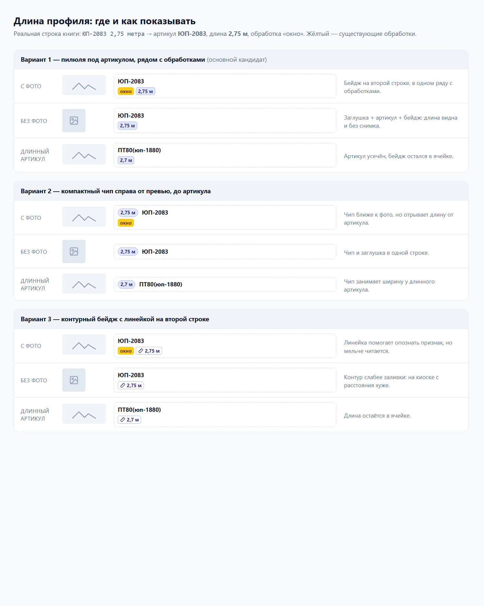
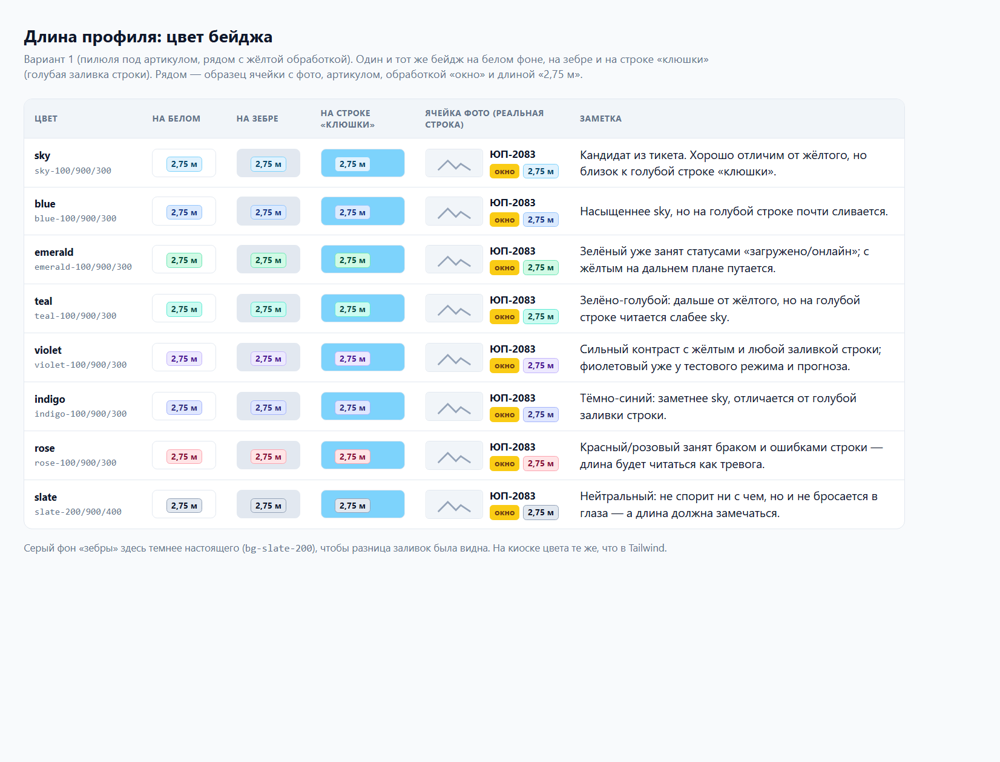
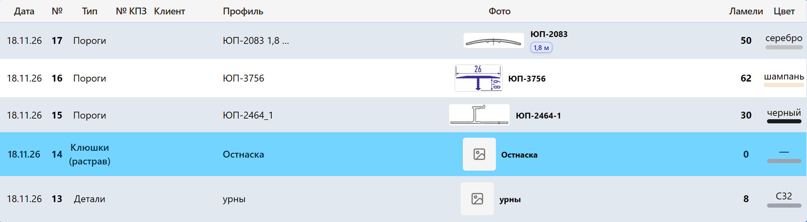

# 0021 — Длина профиля: отдельный бейдж после фото

Задача: [issue #88](https://github.com/mavkasgit/ekranchik-modern/issues/88).
Связанные решения: [ADR 0011](../adr/0011-photo-matching-by-article.md) (поиск
фото по артикулу), [0006](0006-dashboard-row-meaning.md) (смысл строки).
Документация: [photo-matching.md](../photo-matching.md).

## Проблема

Длина профиля пишется в той же ячейке книги, что и артикул:
`ЮП-2083 2,75 метра`, `ЮП-2083 (1.8)`, `ЮП-1880 2.5м`. После перехода на поиск
фото по артикулу ([0011](../adr/0011-photo-matching-by-article.md)) на дашборде
показывается канонический артикул, а длина либо теряется, либо обрезается
(«ЮП-2083 2,75 …»). Оператору она нужна как отдельный признак: по ней выбирают,
что вешать на линию, и её нужно замечать так же, как обработку «окно» или
«греб».

## Замер по текущей книге

Последние 10 000 строк `Учет КПЗ 2026.xlsm` (13.07.26 — 18.11.26):

- **264 строки (2,6 %)** несут длину;
- **46 уникальных написаний**;

| Написание            | Строк | Длина  |
| -------------------- | ----: | ------ |
| `ЮП-1880 2.5м`       |    47 | 2,5 м  |
| `ЮП-2083 (1.8)`      |    30 | 1,8 м  |
| `2525 2.7м`          |    14 | 2,7 м  |
| `ЮП-1401 (3.05м)`    |    14 | 3,05 м |
| `Лайн 3,0м`          |    12 | 3 м    |
| `2626(2.7м)`         |    11 | 2,7 м  |
| `Бинокль 3,0м`       |    11 | 3 м    |
| `ЮП-2083 1.8м`       |    11 | 1,8 м  |
| `ЮП-2083 2,75 метра` |    10 | 2,75 м |
| `юп-2083 2.75м`      |     9 | 2,75 м |
| …                    |       |        |

Полный список — в пробеге по книге (см. «Проверка»). Правила, которые выведены
из данных:

- единицы — **метры**: `м`, `метр`, `метра`, `метров`; запись с точкой и с
  запятой (`2.5м`, `2,75 метра`), с пробелом и без (`2,5 м`, `2.5м`), в
  скобках (`(1.8)`, `(3.05м)`, `(2,7м)`) и без (`3м`, `0,6м`);
- **миллиметры не длина**: `Кр.труба 10мм`, `труба 45мм`, `600*1800мм` —
  это артикулы и размеры заготовок, их не трогаем;
- размеры листов и панелей (`1500х3000х2.0`, `0.8x1000x600`) — не длина;
- скобки без дробной части (`(381)`) — не длина: это номер/партия, а не метры;
- голых чисел без единицы и скобок в выборке нет; на всякий случай их не
  разбираем.

## Решение

### Разбор

`ParsedProfile` (`backend/app/services/profile_name.py`) получает:

- `length_m: float | None` — длина в метрах;
- `length_text: str | None` — как показывать: `2,75 м`, `1,8 м`, `3 м`.

Правила:

1. Сначала скобки: `\(\s*(\d+[.,]\d+)\s*(?:м(?:етр(?:а|ов)?)?\.?)?\s*\)`.
   Скобка с целым числом без единицы (`(381)`) не матчится.
2. Затем число с единицей «м» (но не «мм»):
   `(?<![\d.,])(\d+(?:[.,]\d+)?)\s*м(?:етр(?:а|ов)?)?\.?(?![а-яa-z])`.
3. Найденный фрагмент **удаляется из имени**: `name` становится артикулом.
   Пробелы и пустые скобки подчищаются.
4. `length_text` — число с запятой, без лишних нулей, пробел перед `м`:
   `2.5` → `2,5 м`, `3.00` → `3 м`, `3.05` → `3,05 м`.

`split_profiles` разбивает ячейку по `+`/`/` **до** разбора, поэтому длина
привязывается к своему профилю: `ЮП-2083(1.8м)+ ЮП-4863` — длина только у
первого.

### API

`ProfileInfo` (`backend/app/schemas/profile.py`):

- `length_m: float | None`;
- `length_text: str | None`.

`_build_profiles_info` (`backend/app/api/routes/dashboard.py`) передаёт оба поля;
их получают обе таблицы — очередь загрузки (`GET /api/dashboard`) и выгрузка
(`GET /api/dashboard/opcua-unload-matched`). Поле `name` остаётся сегментом
ячейки как записан (`parsed.raw`), `canonical_name` — артикул каталога.

Каталожную длину (`profiles.length`, мм) **не подставляем**: бейдж показывает
только то, что написано в книге. Длина заказа и длина артикула могут
расходиться (`ЮП-2083` в каталоге 2700 мм, в книге 2,75 м и 1,8 м) — это разные
вещи, и выдуманное число хуже отсутствующего.

### Интерфейс

Бейдж стоит в ячейке **Фото**, после снимка, рядом с бейджами обработок:

- отдельная тема, не жёлтая (обработки уже жёлтые): например, голубая
  `bg-sky-100 text-sky-900 border-sky-300`; окончательный цвет — по прототипам;
- текст — `length_text` («2,75 м»), иконка-линейка не обязательна;
- виден и у строки без фото (заглушка + артикул + бейдж), и в выгрузке, и в
  очереди;
- несколько профилей — у каждого свой бейдж в своём блоке;
- доступность: `title`/`aria-label` «Длина 2,75 м»; бейдж не заменяет артикул
  и не переносит фото на второй ряд;
- длинная подпись артикула не должна выталкивать бейдж за ячейку.

### Прототипы

До кода — статическая страница в `.scratch/` с реальной строкой
`ЮП-2083 2,75 метра` и 2–3 вариантами:

1. пилюля под артикулом рядом с обработками (основной кандидат);
2. компактный чип справа от превью, до артикула;
3. контурный бейдж с иконкой линейки на второй строке.

Выбранный вариант — скриншот в тикете/PR, чтобы цвет и место можно было
обсудить до вёрстки.

### Документация

- `docs/photo-matching.md` — раздел «Длина профиля»: форматы, что не длина,
  как связана с поиском фото;
- ADR 0012 «Длина профиля — отдельная аннотация»: `parse_profile` перестаёт
  держать размер в имени, запасной поиск фото остаётся для прочих хвостов;
- `CONTEXT.md` — «Артикул»/«Профиль»: длина из книги — отдельный признак, не
  часть артикула.

## Вне объёма

- правка книги и синка каталога;
- миллиметры и размеры заготовок;
- запись книжной длины в `profiles.length` (поле каталога принадлежит
  источнику, ADR 0010);
- перенос длины в боковую очередь и прогноз по ваннам — отдельная задача, если
  понадобится.

## Проверка

1. Unit `backend/tests/unit/test_profile_name.py`: все 46 написаний, плюс
   ложные — `Кр.труба 10мм`, `труба 45мм`, `1500х3000х2.0`, `0.8x1000x600`,
   `ЮП-2900 (381)`, `ЮП-2464-1`; обработки вместе с длиной
   (`ЮП-460 гребенка 3м`).
2. Unit каталога: после очистки имени фото находится без запасного прохода;
   запасной проход остаётся для `381 (ЮП-2900 окно)` и подобных хвостов.
3. Схема: `ProfileInfo` отдаёт оба поля; дашбордный ответ содержит длину в
   обеих таблицах (тест на `_build_profiles_info` или интеграционный).
4. `scripts/photo-match-report.py` — блок «Длины»: сколько строк и написаний,
   какие форматы, что не разобралось (0 ложных). Прогон на последних 10 000
   строках текущей книги: 264 строки / 46 написаний.
5. Руками на стенде: строка `ЮП-2083 2,75 метра` — бейдж «2,75 м» того же
   цвета в очереди и в выгрузке, у строки без фото тоже; скриншот.
6. `mise run check`, `mise run test`.

## Реализация

Выбран **вариант 1** — пилюля на второй строке под артикулом, в одном flex-ряду
с жёлтыми бейджами обработок. Цвет — **indigo**
(`bg-indigo-100 text-indigo-900 border-indigo-300`): после сравнения цветов
(прототип `.scratch/length-badge-colors.html`) это решение пользователя, а не
молчаливая замена sky из спеки. `title`/`aria-label` — «Длина 2,75 м».

Фактический прогон 18.11.2026 по последним 10 000 строкам книги: **266 строк с
длиной, 45 уникальных написаний, 0 неразобранных** (блок «Длины» в отчёте,
ключ `lengths` в JSON). В замере тикета было 46 / 264: последние 10 000 строк —
скользящее окно, его состав меняется по мере роста книги, поэтому 45 — это
фактический набор написаний, а не «46 минус один».

Скриншоты:

Случай без фото покрыт markup-тестом
`frontend/src/components/ProfilePhoto.test.tsx`: заглушка + артикул + бейдж
длины.

## Открытый вопрос

Решён: цвет и место бейджа выбраны по прототипам — вариант 1, indigo;
поведение (показывать только книжную длину, не подставлять каталожную)
зафиксировано выше.
